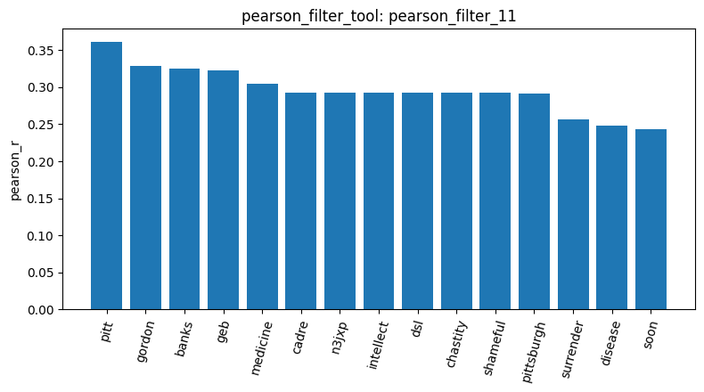
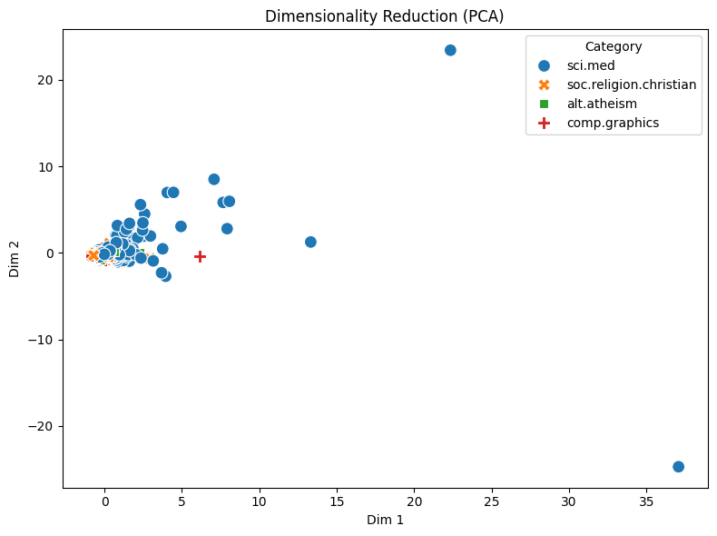

# Your report

Name:沈日生
Student ID: M1157114

I ran all 17 steps of the full pipeline. I loaded 2,257 articles and sampled 600 documents (`sample_data_6`) because of API limits and speed. The document-term matrix (`build_dtm_7`) has 600 rows and 17,622 columns, and it is 99.09% sparse.

The variance filter (`variance_filter_10`) kept 4,663 terms, and the Pearson filter for sci.med (`pearson_filter_11`) kept 383 terms. For visualization, I first tried `visualize_result_tool` on `term_frequency_8`, but it failed because that result has no tabular data. I changed to `pearson_filter_11` and the chart worked.

I observed that email header words dominate the pattern mining results (`mine_patterns_13`). The top patterns for sci.med are words such as "subject" (support 172), "lines" (168), and "organization" (167), not medical terms.

The first two PCA components (`reduce_dimensions_14`) explain only about 20% of the variance (0.1264 and 0.0762).

I binarized the category labels (`binarize_labels_15`). The result has 600 samples and 4 classes: alt.atheism, comp.graphics, sci.med, and soc.religion.christian. The cosine similarity between documents 0 and 1 was 0.2085 (`cosine_similarity_16`), which means that the two documents share only a mild overlap in vocabulary. A limitation is that I did not run the Spearman filter.