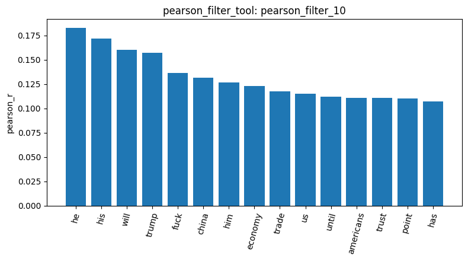
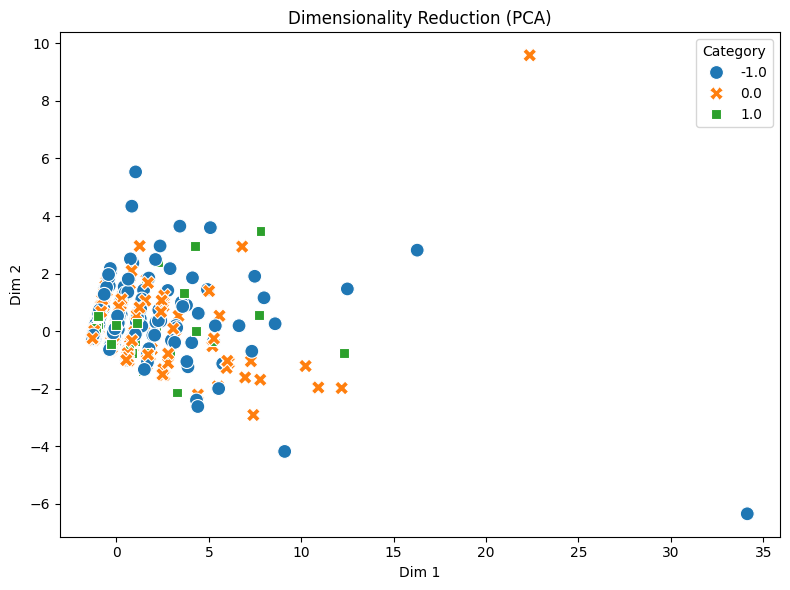

Name:沈日生
Student ID:M1157114

This pipeline run comprised 16 analysis steps (15 result IDs plus one visualization). I loaded 847 articles (`load_dataset_1`) and skipped sampling because the dataset size was small. The dataset has class imbalance across 3 categories, short texts averaging about 150 characters (`describe_data_5`), 23 duplicate entries (`check_duplicates_4`), and a vocabulary of 4,346 terms (`build_dtm_6`). Notably, the tools worked properly even when handling numeric category labels like -1.0, 0.0, and 1.0.

For feature selection, the variance filter kept 506 terms (`variance_filter_9`). Using a target class of -1.0 and a threshold of 0.05, the Pearson filter kept 94 terms (`pearson_filter_10`). Pattern mining with min_sup=20 and target class -1.0 produced only 8 single-word patterns (`mine_patterns_12`), as the short document length limited multi-word combinations.

In dimensionality reduction (`reduce_dimensions_13`), the first two PCA components explained about 60.5% of the total variance. A possible reason for this higher variance explained compared to the newsgroup dataset is that unstandardized high-frequency words might dominate the first principal component across the 94 selected terms. The cosine similarity between documents 1 and 4 was 0.0 (`cosine_similarity_15`) because they shared no common words among the 94 retained terms.

During execution, I noticed a few tool limitations. When running `describe_data_5`, the agent mistakenly reported that plotting failed, even though the chart file was already saved. Additionally, the DTM heatmap (`dtm_heatmap_8`) shows only the first 20 documents and 20 terms, which limits the overall view. Overall, for very short texts, sparse representations struggle with word overlap, suggesting dense semantic embeddings could be a better choice for future analysis.